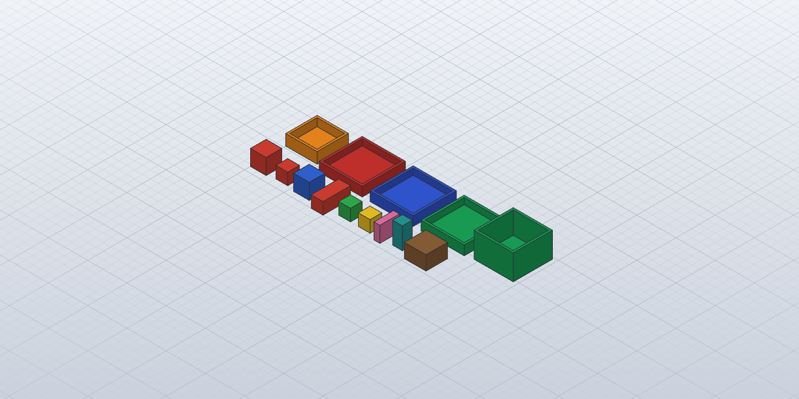

# Printable objects and trays

The objects and trays the twin's scenes use, at the sizes the simulation uses,
so the real arm can practise on what the simulated one did.



| Folder | Format | For |
|---|---|---|
| `stl/` | STL, millimetres | A slicer (OrcaSlicer, Bambu Studio, PrusaSlicer) |
| `step/` | STEP AP242, millimetres | CAD: to change a part, or to add a fillet or a label |
| `solidcraft/` | SolidCraft design | Editing in SolidCraft |

Each part sits on its base (z = 0), centred, the way up it prints and the way
up it stands on the desk. Open boxes print open side up, with no supports.

## The parts

Sizes are length x width x height in mm; a box's pocket is its inside length,
width and depth. "Sim mass" is the part's mass in the simulation; "solid PLA"
is what it would weigh printed solid.

| Part | Size | Pocket | Colour | Sim mass (g) | Solid PLA (g) | What it is for |
|---|---|---|---|---|---|---|
| `red_cube` | 40 x 40 x 40 |  | #D94033 | 40 | 79 | The red cube every scene starts from. |
| `red_small_cube` | 30 x 30 x 30 |  | #D94033 | 20 | 33 | Beside the red cube: "the small one". |
| `blue_cube` | 40 x 40 x 40 |  | #3366D9 | 40 | 79 | A cube for sorting by colour. |
| `red_bar` | 30 x 70 x 30 |  | #D94033 | 35 | 78 | A red bar: grip it across its 3 cm side. |
| `green_cube` | 30 x 30 x 30 |  | #33B24C | 20 | 33 | A cube for sorting by colour. |
| `yellow_cube` | 30 x 30 x 30 |  | #F2C726 | 20 | 33 | A cube for sorting by colour. |
| `pink_slab` | 15 x 50 x 40 |  | #E673A6 | 20 | 37 | Thin: the jaws close nearly shut on it. |
| `teal_tower` | 25 x 25 x 55 |  | #269999 | 30 | 43 | Tall and narrow: the arm's own pick knocks it over about half the time. |
| `brown_block` | 55 x 55 x 36 |  | #8C6138 | 50 | 135 | Wide: the jaws open nearly as far as they approach. |
| `orange_box` | 80 x 80 x 28 | 70 x 70 x 20 | #F28C1F | 80 | 101 | Pushed about by the arm; what is in it rides along. |
| `red_bin` | 110 x 110 x 24 | 100 x 100 x 16 | #CC332E | fixed | 162 | Sorting desk tray, fixed to the desk. |
| `blue_bin` | 110 x 110 x 24 | 100 x 100 x 16 | #3359D9 | fixed | 162 | Sorting desk tray, fixed to the desk. |
| `green_bin` | 110 x 110 x 24 | 100 x 100 x 16 | #1AA659 | fixed | 162 | Sorting desk tray, fixed to the desk. |
| `goal_box` | 100 x 100 x 64 | 90 x 90 x 56 | #1AA659 | fixed | 231 | The pick-and-place table's goal box, fixed to the table. |

The colours are the simulation's. A close filament colour is fine. The
pointing model and the agents go by colour names ("red cube"), not exact
shades, but keep the red cube clearly red and the bins clearly their colours.

## Printing them

- **Size matters more than looks.** The grasp is judged by width to the
  millimetre (a 40 mm cube is held at 40 mm). Turn on your slicer's
  elephant-foot compensation, and check a cube with calipers.
- **Weight.** Printed solid, most parts weigh about twice their sim mass. Use
  infill to come closer: print one, weigh it, and adjust. The movable
  `orange_box` matters most: at 80 g the arm can push it with a cube inside.
- **Trays and the goal box** are fixed to the desk in the simulation. Tape or
  screw them down where `sim/table_scenes.py` puts them.
- **Where the twin differs.** In the simulation a tray's walls start 4 mm above
  the table, at the middle of its floor plate. The printed trays are flat
  underneath, as a real tray should be. Nothing that matters changes: the inside
  is the same size and depth.

## Camera calibration checkerboard

`checkerboard_9x6_25mm.pdf` (and `.png`) is for calibrating the real arm's
cameras: 10 x 7 squares of 25 mm, so 9 x 6 inner corners, on US Letter,
landscape. Print it at 100 % (no "fit to page"), check that the bar under it
measures 50 mm, and tape it flat to something stiff. `scripts/capture_frames.py`
saves frames from one camera and says whether each shows the whole board.

## The bean bag

The bean bag is soft, so it is not printed. Sew one: a fabric pouch
60 x 50 mm, filled to about 24 mm thick and 30 g, with plastic pellets or rice.
In the simulation it is blue, and the grip takes it at any angle.

## Making the files again

The sizes come from the simulation's own constants
(`src/xbox_soarm_teleop/sim/printables.py` reads them), so after changing an
object's size, rebuild everything with SolidCraft's command line tool:

```bash
uv run python scripts/export_printables.py
```

`tests/test_printables.py` fails when the STL or STEP files no longer match the
simulation.
